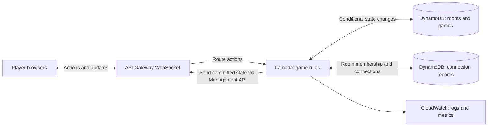
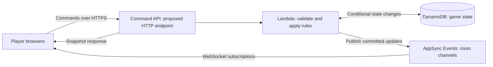
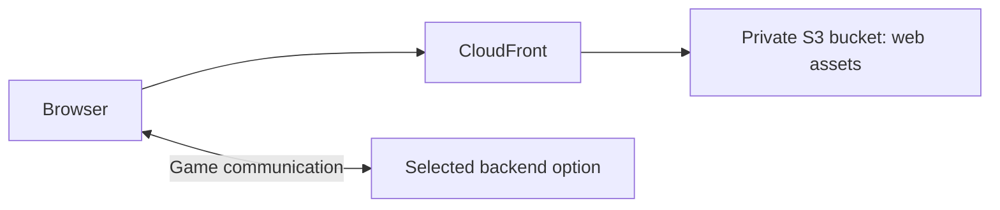

# Architecture Alternatives

[Back to project overview](../../README.md)

**Selected: Option A** (API Gateway WebSocket + Lambda + DynamoDB), for its learning value. Not deployed yet. The diagrams show logical responsibilities, not complete deployment specifications.

## Option A: API Gateway WebSocket + Lambda + DynamoDB

A candidate when the learning goal is to understand the individual AWS building blocks.

API Gateway holds the WebSocket connections. Lambda handles individual actions; it does not keep a permanently running game process. Connection records associate connected clients with rooms. The application must implement broadcasts to the appropriate connections and clean up stale records.

DynamoDB is a candidate for durable game state and conditional changes. The two database boxes represent logical data groups, not a decision to create separate tables.

**Benefits:** explicit responsibilities; useful practice with event-driven execution, permissions, persistence, and connection lifecycles.

**Tradeoffs:** more connection and broadcast logic; distributed updates require careful concurrency handling; function startup and network latency affect responsiveness.

## Option B: AppSync Events + game logic + DynamoDB

A candidate when the learning goal emphasizes managed publish/subscribe channels.

In this proposed layout, commands go through a server-controlled endpoint, and AppSync distributes accepted updates. Clients must be authorized for their room subscriptions and must not be allowed to forge authoritative updates.

AppSync Events also supports data source integrations, including Lambda and DynamoDB. A future variation could process commands through an event handler instead of a separate command API. That requires its own authorization, failure, and response design.

**Benefits:** less custom fan-out logic; room channels provide a natural messaging model; Events does not require adopting GraphQL.

**Tradeoffs:** game rules, durable state, concurrency, and reconnect recovery remain application responsibilities. A channel is not the game database or an automatic replay mechanism.

## Frontend hosting, shared by either option

S3 with CloudFront is one possible hosting approach. Amplify Hosting is another option to evaluate. No hosting configuration has been chosen.

## Comparison

| Question | API Gateway WebSocket | AppSync Events |
| --- | --- | --- |
| Who routes room updates? | Application resolves connections and sends callbacks | Service delivers published events to authorized subscribers |
| Who validates SET claims? | Application logic | Application logic |
| Who resolves simultaneous state changes? | Application plus database conditions | Application plus database conditions |
| Who restores a disconnected player? | Application snapshot/recovery flow | Application snapshot/recovery flow |
| Main learning emphasis | Connections, Lambda routes, and orchestration | Managed channels and event integration |

**Decision:** Option A, because its components expose several transferable AWS concepts. Option B remains a reasonable alternative if messaging plumbing becomes the bottleneck.

Operational notes for Option A:

- `PostToConnection` to a closed connection returns `GoneException` (HTTP 410); delete that connection record as part of the fan-out.
- API Gateway closes WebSocket connections after an idle timeout and a maximum connection duration, so reconnecting is a normal path, not an edge case. Check current limits before designing heartbeats.

## Before choosing

Discuss the learning priority, acceptable complexity, expected room sizes, identity requirements, budget, and how to test locally. Estimate costs for realistic usage rather than assuming a free deployment. Neither option promises strict ordering by physical click time.

## Official references

- [API Gateway WebSocket overview](https://docs.aws.amazon.com/apigateway/latest/developerguide/apigateway-websocket-api-overview.html)
- [AWS WebSocket chat tutorial](https://docs.aws.amazon.com/apigateway/latest/developerguide/websocket-api-chat-app.html)
- [AppSync Events concepts](https://docs.aws.amazon.com/appsync/latest/eventapi/event-api-concepts.html)
- [AppSync Events data source integrations](https://docs.aws.amazon.com/appsync/latest/eventapi/data-source-integrations.html)
- [DynamoDB conditional operations](https://docs.aws.amazon.com/amazondynamodb/latest/developerguide/example_dynamodb_Scenario_ConditionalOperations_section.html)
