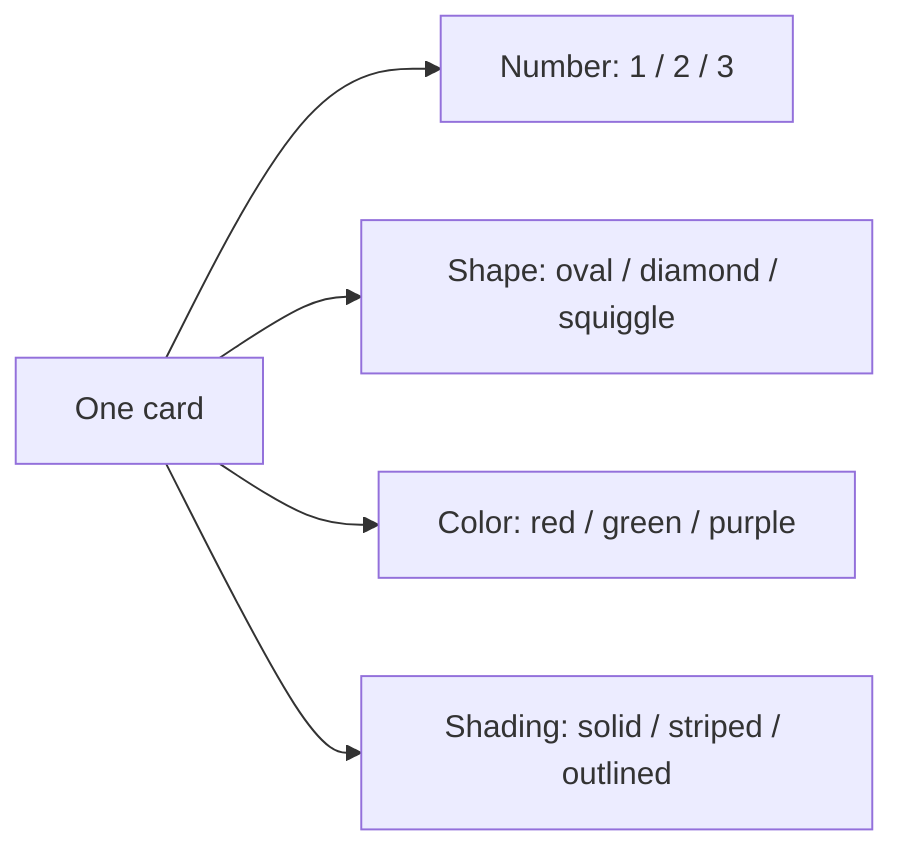

# Game and Cards

[Back to project overview](../../README.md)

This guide summarizes the classic multiplayer game. Proposed digital behavior is separated from the physical rules.

## The deck

| Attribute | Values |
| --- | --- |
| Number | One, two, three |
| Shape | Oval, diamond, squiggle |
| Color | Red, green, purple |
| Shading | Solid, striped, outlined |

Every possible combination appears once: **3 × 3 × 3 × 3 = 81 unique cards**. All symbols within one card share its shape, color, and shading.

## What makes a SET?

For each of the four attributes, check the three cards separately. The attribute must be identical on all three cards or different on all three. Two matching values and one different value invalidate the combination.

Example: one red outlined oval, two green outlined ovals, and three purple outlined ovals form a SET. Number and color differ across all three; shape and shading match.

## Classic multiplayer flow

1. Shuffle the deck and deal 12 cards face up.
2. Players search simultaneously.
3. A player calls SET before taking three cards. They briefly control the board while identifying the combination.
4. A valid SET earns one point; remove its cards and replenish to 12 while the deck allows.
5. An incorrect claim costs one point; its cards stay on the board.
6. If everyone agrees there is no SET, deal three additional cards. Do not replenish after a successful claim while the board still has at least 12 cards.
7. Finish when the deck is exhausted and no SET remains. Highest score wins.

The official rules describe a short selection period after calling SET, without prescribing an exact number of seconds.

## Digital choices to discuss

| Topic | Candidate behavior | Unresolved detail |
| --- | --- | --- |
| Claiming | Announce, reserve, then select | Reservation duration and timeout penalty |
| Alternative interaction | Select three cards and submit immediately | Whether fidelity to the physical announcement matters |
| No SET available | Server verifies before adding cards | Automatic addition, player request, or room vote |
| Simultaneous claims | Only one reservation can be committed | How to explain network-dependent priority |
| Accessibility | Preserve attribute distinctions with optional aids | Color palette, patterns, keyboard controls |
| Ending | Finish after deck exhaustion and no remaining SET | Display tied winners and rematch flow |

## Sources

- [Official rules and illustrated card examples](https://www.playmonster.com/wp-content/uploads/2020/01/SETRules.pdf)
- [Publisher overview](https://playmonster.com/product/set/)
- [The Joy of SET: deck construction](https://www.setgame.com/sites/default/files/teacherscorner/THE%20JOY%20OF%20SET.pdf)
