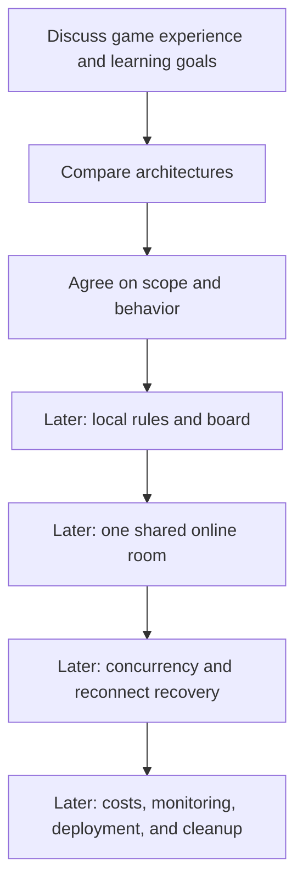

# Learning Roadmap and Open Decisions

[Back to project overview](../../README.md)

The project begins with discussion. This is a learning path, not an approved implementation plan or a delivery schedule.

## Suggested progression

Only the first two stages are in scope now. Later stages require a decision to start implementation.

## Concepts and tangible outcomes

| Concept | Why the game needs it | Future learning outcome |
| --- | --- | --- |
| AWS regions and IAM | Resources need locations and limited permissions | Explain which component may access each resource |
| Static hosting | Players need a web page | Explain browser assets versus backend execution |
| WebSockets and events | Players share changing state | Trace one action from one player to the whole room |
| Lambda | Rules execute on server-side actions | Explain handler lifetime and why memory is not durable game state |
| DynamoDB | Rooms and games must survive reconnects | Describe access patterns and conditional writes |
| Authentication and authorization | Player identity and room access differ | Separate knowing who a player is from allowing an action |
| CloudWatch | Failures and latency need evidence | Trace a rejected or delayed claim |
| Billing and cleanup | Experiments create resources | Estimate usage and remove unused resources |
| Infrastructure as code | Environments should be reproducible | Choose tooling after understanding the architecture |

## Discussion milestones

1. Describe the first complete game with friends.
2. Decide how claiming works and how the game handles mistakes.
3. Choose a backend option based on the learning goal.
4. Agree on identity, room size, budget, and a single initial region.
5. Write the accepted design and only then consider implementation.

## Decision log

| Topic | Status | Current position |
| --- | --- | --- |
| Purpose | Confirmed | Learn AWS through a multiplayer SET web project |
| Repository | Confirmed | Public, with English documentation |
| Current stage | Confirmed | Discussion only; no code |
| Real-time backend | Open | Compare API Gateway WebSocket and AppSync Events |
| Claim interaction | Open | Reservation-first proposed; direct submission alternative |
| Language and frontend | Open | No stack selected |
| Accounts and guests | Open | Define identity and room authorization |
| Region and budget | Open | Decide before provisioning |
| Infrastructure tooling | Open | Discuss after architectural choice |
| Licensing | Open | No license selected yet |

## Later operational discussion

Before any deployment, identify cost drivers such as active connection time, message volume, database operations, function execution, logs, and asset delivery. Check current pricing for the chosen region. Budget alerts are notifications, not a guaranteed spending cap.

Use a dedicated learning environment, narrowly scoped permissions, and a documented cleanup process when implementation begins. No AWS resources are created by this repository at this stage.

## First conversation to have

Which part would be most valuable to learn first: deploying a web application, connecting AWS services, or understanding how simultaneous multiplayer actions are coordinated?
