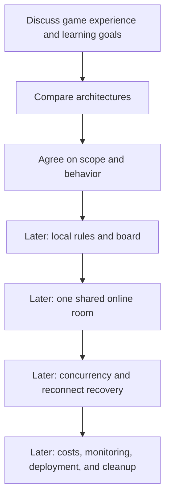

# Learning Roadmap and Open Decisions

[Back to project overview](../../README.md)

Discussion is done for the MVP; the local game is implemented. This is a learning path, not a delivery schedule.

## Suggested progression

Done: discussion, architecture choice, local rules and board. Next: one shared online room.

## Concepts and tangible outcomes

| Concept | Why the game needs it | Future learning outcome |
| --- | --- | --- |
| AWS regions and IAM | Resources need locations and limited permissions | Explain which component may access each resource |
| Static hosting | Players need a web page | Explain browser assets versus backend execution |
| WebSockets and events | Players share changing state | Trace one action from one player to the whole room |
| Lambda | Rules execute on server-side actions | Explain handler lifetime and why memory is not durable game state |
| DynamoDB | Rooms and games must survive reconnects | Describe access patterns and conditional writes |
| Authentication and authorization | Player identity and room access differ | Separate knowing who a player is from allowing an action |
| CloudWatch | Failures and latency need evidence | Trace a rejected or delayed claim |
| Billing and cleanup | Experiments create resources | Estimate usage and remove unused resources |
| Infrastructure as code | Environments should be reproducible | Choose tooling after understanding the architecture |

## Discussion milestones

1. Describe the first complete game with friends.
2. Decide how claiming works and how the game handles mistakes.
3. Choose a backend option based on the learning goal.
4. Agree on identity, room size, budget, and a single initial region.
5. Write the accepted design and only then consider implementation.

## Decision log

| Topic | Status | Current position |
| --- | --- | --- |
| Purpose | Confirmed | Learn AWS through a multiplayer SET web project |
| Repository | Confirmed | Public, with English documentation |
| Current stage | Confirmed | Local game implemented (`packages/engine`, `apps/web`) |
| Real-time backend | Confirmed | Option A: API Gateway WebSocket + Lambda + DynamoDB |
| Claim interaction | Confirmed (MVP) | Submit three cards directly; reservation flow may come later |
| Data model | Confirmed (MVP) | One game item, conditional write on `version` |
| No SET available | Confirmed | Server deals three more cards automatically |
| Language and frontend | Confirmed | TypeScript; React + Vite |
| Accounts and guests | Confirmed (MVP) | Guest token in the browser; accounts later |
| Infrastructure tooling | Confirmed | AWS CDK in TypeScript |
| Licensing | Confirmed | MIT |
| Region and budget | Open | Compare `sa-east-1` and `us-east-1` before provisioning |

## Later operational discussion

Before any deployment, identify cost drivers such as active connection time, message volume, database operations, function execution, logs, and asset delivery. Check current pricing for the chosen region. Budget alerts are notifications, not a guaranteed spending cap.

Use a dedicated learning environment, narrowly scoped permissions, and a documented cleanup process when implementation begins. No AWS resources are created by this repository at this stage.

## Next milestone: one online room

1. AWS account hygiene: dedicated IAM user/role, MFA, budget alert, chosen region.
2. CDK app with a DynamoDB table and an API Gateway WebSocket API (`$connect`, `$disconnect`, `command`).
3. Lambda handler: read game item → `applyCommand` from `@set/engine` → conditional put on `version` → retry on conflict → broadcast `toPublicState` with `PostToConnection` (delete connections that return `GoneException`).
4. `WebSocketGameClient` in `apps/web` implementing the existing `GameClient` interface.
5. S3 + CloudFront hosting for `apps/web/dist`.
