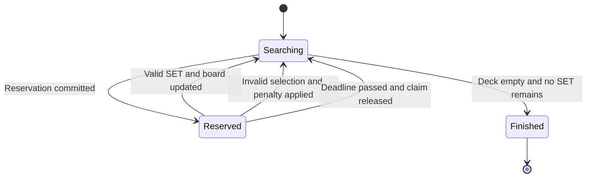

# Real-Time Coordination

[Back to project overview](../../README.md)

**Proposed behavior for discussion, not an implementation specification.** Transporting messages quickly and deciding which action is valid are separate problems.

## One authoritative game state

The server owns the shuffled deck, visible cards, scores, room membership, game version, and any active claim. Browsers send intentions, not replacement scores or boards. Do not send the hidden deck order to players.

Each committed change increments a game version. A client can then ignore older updates and request a current snapshot when it detects a gap.

## Two players announce SET

The following proposal resembles the physical game: announce first, then select cards during a short reservation.

```mermaid
sequenceDiagram
    participant A as Player A
    participant B as Player B
    participant S as Game service
    participant D as Durable state
    A->>S: Announce SET for board version 12
    B->>S: Announce SET for board version 12
    S->>D: Reserve if version matches and no active claim
    D-->>S: Reservation committed for A
    S->>D: Attempt competing reservation for B
    D-->>S: Condition fails
    S-->>A: Reservation accepted with deadline
    S-->>B: Board reserved; current state
    A->>S: Submit three card IDs and claim ID
    S->>D: Commit validated result if claim and version still match
    D-->>S: Updated board, score, and version
    S-->>A: Committed update
    S-->>B: Committed update
```

A wins in this example, but not necessarily because A clicked first or reached the API first. With concurrent handlers, priority belongs to the reservation that successfully commits first. Client timestamps cannot establish trustworthy priority. Strict arrival ordering would need additional design and would still not eliminate network differences.

## Claim lifecycle



A reservation needs an owner, a unique claim ID, and a server deadline. Submission must check all three. Database expiration cleanup must not be used as a precise gameplay timer. The mechanism for releasing and broadcasting expired reservations remains open.

## Failure cases to design deliberately

| Situation | Proposed handling |
| --- | --- |
| Both players claim together | Conditional reservation allows only one winner |
| Same command arrives twice | Request ID permits retry without scoring twice |
| Cards changed before submission | Reject stale action and return current state |
| Player disconnects during reservation | Reservation deadline prevents indefinite blocking |
| Old update arrives late | Ignore versions older than the displayed state |
| Broadcast fails after a successful write | Preserve committed state; recover via snapshot and consider durable delivery retries |
| Browser reconnects | Reauthorize membership, reconnect, and fetch current state |
| Subscription starts during snapshot retrieval | Buffer updates and reconcile versions to avoid missing a change |

Stale-state conflicts should be distinguished from genuinely invalid SETs; whether any penalty applies must be agreed before implementation. A repeated request must return the prior outcome, not execute the action again.

## Atomicity and delivery

A score change, card removal, replacement draw, and claim release must commit together. A possible early model is one compact game item with a conditional version update; separate records would require a transaction strategy. Neither data model is selected yet.

A successful database write does not guarantee that every client received a message. The initial design must include recovery; whether to add an outbox or stream-based delivery is a later tradeoff. A missed final update also needs a recovery trigger, such as a periodic version check, because no later message may arrive to expose the gap.

## Questions still open

- Announce first, or submit selected cards immediately?
- How long does a reservation last, and what is the timeout penalty?
- Can a disconnected player reclaim their identity without an account?
- How should the UI explain a simultaneous-claim loss?
- Should clients receive full public snapshots or smaller changes?
- What responsiveness target should we measure before declaring the game comfortable?

## Reference

[Conditional operations in DynamoDB](https://docs.aws.amazon.com/amazondynamodb/latest/developerguide/example_dynamodb_Scenario_ConditionalOperations_section.html) provide the underlying conditional-write mechanism; the gameplay protocol above is this project's proposal.
